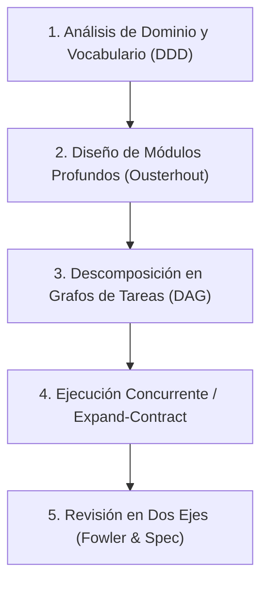

# 🏛️ Architect-Guardian: Arquitectura de Software, Dominio y Calidad de Diseño

Esta skill proporciona los fundamentos de ingeniería de software para erradicar el *vibe coding* y la entropía arquitectónica, garantizando módulos profundos, interfaces de alto apalancamiento, un lenguaje de dominio unificado y revisiones rigurosas en dos ejes.

---

## 🎯 Filosofía Central

> **"Un software excelente minimiza la complejidad acumulada. Un módulo profundo ofrece mucho comportamiento detrás de una interfaz simple y estable. El código no solo debe funcionar hoy; debe ser fácil de entender para futuros agentes y desarrolladores a través de costuras limpias y un vocabulario preciso."**

---

## 🧭 Flujo de Trabajo Contextual



---

## 📋 Protocolo de los 5 Pilares de Architect-Guardian

### 1. Modelado de Dominio Ubicuo (DDD)
- **Eliminación de Términos Difusos**: No permitas nombres como `Manager`, `Processor`, `Helper` o `Handler`. Identifica la entidad de negocio real (`Order`, `Subscription`, `Asset`, `Invoice`).
- **Glosario Vivo (`GLOSSARY.md`)**:
  - Si el proyecto maneja lógica de negocio, mantén `GLOSSARY.md` en la raíz.
  - Define términos de 1 palabra en vez de descripciones de 20 palabras para ahorrar tokens de contexto en futuras sesiones.
  - *Regla*: Cero detalles de implementación en el glosario.
- **Registros ADR (`docs/adr/`)**:
  - Propón o crea un ADR solo si la decisión es **difícil de revertir**, **sorprendente sin contexto**, y **resultado de un trade-off real**.
  - Consulta [Modelado de Dominio y ADRs](./references/domain_modeling_and_glossary.md).

### 2. Diseño de Módulos Profundos y Costuras Reales
- **Módulos Profundos (*Deep Modules*)**: La interfaz debe ser pequeña y fácil de aprender; la implementación interna debe resolver toda la complejidad, invariantes y validaciones.
- **Prohibido el Pasamanos (*Middle Man*)**: No crees clases o funciones cáscara vacías que solo deleguen.
- **Test de la Eliminación**: Imagina borrar el módulo: si la complejidad desaparece, era un pasamanos innecesario; si se esparce en múltiples clientes, el módulo se justifica.
- **Costuras Reales (*Seams*)**: Solo crea interfaces/adaptadores abstractos si existen 2 o más implementaciones concretas que las justifiquen.
- Consulta [Módulos Profundos y Costuras](./references/deep_modules.md).

### 3. Descomposición en Grafos de Dependencia (DAG)
- **Tracer Bullets Verticales**:
  - Ante requerimientos grandes, divide el trabajo en cortes verticales completos (esquema -> lógica -> interfaz/API -> tests de integración).
  - Cada corte debe ser operable y verificable de forma autónoma.
- **La Frontera Lista (*Ready Frontier*)**:
  - Declara qué tareas bloquean a cuáles (`Blocked by:`).
  - Las tareas sin bloqueadores pendientes pueden implementarse de forma concurrente mediante subagentes independientes sin conflictos de git.
- **Refactorizaciones Transversales (*Expand-Contract*)**:
  - Para cambios masivos de firmas o tipos que afecten a todo el repo, aplica: *Expandir* (nueva firma en paralelo) -> *Migrar* (en lotes acotados) -> *Contraer* (borrar la vieja forma).
- Consulta [Descomposición en Grafos de Tareas](./references/task_graph_decomposition.md).

### 4. Auditoría Automatizada con `architect_guard.py`
Antes de concluir una tarea arquitectónica o revisión, ejecuta el auditor estático:

```bash
python C:/Users/Petiso/.gemini/config/plugins/architect-guardian/skills/architect-guardian/scripts/architect_guard.py .
```

Verifica:
1. Presencia y salud de `GLOSSARY.md` y `docs/adr/`.
2. Integridad de tickets y tareas en la frontera lista.
3. Detección de code smells (Mysterious Name, Message Chains, Speculative Generality).

### 5. Revisión de Código en Dos Ejes Ciegos (*Two-Axis Review*)
Al evaluar el resultado de una implementación:
- **Eje 1: Estándares y Fowler Smells**: Audita el diff buscando code smells clásicos (*Refactoring*, ch. 3). Consulta [Catálogo de Fowler Code Smells](./references/fowler_code_smells.md).
- **Eje 2: Fidelidad a la Especificación**: Comprueba que no falte ningún requerimiento, que no haya comportamiento no solicitado (*scope creep*), y que los casos borde cumplan la spec.
- Consulta [Revisión en Dos Ejes](./references/two_axis_code_review.md).

---

## 📝 Protocolo de Reporte Final
En toda respuesta que involucre diseño de software, refactorización o descomposición, incluye siempre el bloque:

```markdown
### 🏛️ Arquitectura, Dominio y Diseño (Architect-Guardian)
- **Módulos y Costuras**: [Profundidad de interfaces creadas/modificadas y justificación de costuras].
- **Modelado de Dominio (DDD)**: [Vocabulario de negocio alineado / GLOSSARY.md o ADR registrado si aplica].
- **Descomposición & Flujo**: [Cortes verticales implementados / Frontera de tareas gestionada].
- **Revisión en Dos Ejes**: [Estándares & Code Smells evaluados | Fidelidad estricta a la spec sin scope creep].
```
