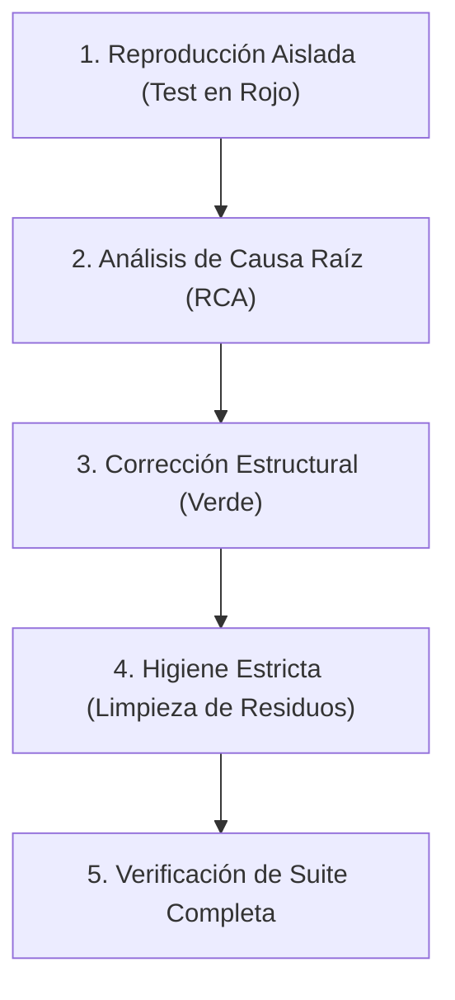

# 🐞 Debug-Guardian: Depuración Rigurosa, Calidad de Testing e Higiene de Código

Esta skill proporciona una metodología estructurada para garantizar que la resolución de problemas por parte de agentes de IA sea **profunda, determinista, libre de regresiones y libre de residuos de diagnóstico**.

---

## 🎯 Objetivo Fundamental: Cero "Parches Curita" y Cero Regresiones

El estándar de oro de Debug-Guardian es:
> **Todo defecto debe ser reproducido primero mediante una prueba automatizada en rojo, resuelto en su causa raíz estructural (sin silenciar errores ni degradar tipos), verificado contra la suite completa de pruebas, y entregado con cero residuos de depuración (`console.log`, `print`, `breakpoint`).**

---

## 📋 Protocolo de 5 Pasos para el Agente



### Paso 1: Reproducción Aislada (Test en Rojo)
Ante cualquier bug reportado:
1. No toques la lógica de negocio todavía.
2. Escribe una prueba automatizada que replique la entrada o condición del fallo.
3. Ejecuta la prueba y verifica que **falla** (`RED`). Esto demuestra que el problema ha sido capturado de forma determinista.
- Consulta [Patrones de Testing](./references/testing_patterns.md) para tu ecosistema.

### Paso 2: Análisis de Causa Raíz (RCA)
- Aplica la técnica de los **5 Porqués** para rastrear dónde se originó el dato defectuoso o la asunción inválida.
- **Regla de Oro**: Prohibido aplicar parches superficiales (como silenciar con `try/catch` vacíos, añadir `as any`, o forzar chequeos nulos que enmascaren defectos del flujo previo).
- Consulta la [Guía de Causa Raíz](./references/root_cause_analysis.md) para evitar anti-patrones comunes.

### Paso 3: Corrección Estructural (Test en Verde)
1. Modifica la lógica en el componente donde se origina la falla.
2. Ejecuta el test de reproducción y verifica que **pasa limpiamente** (`GREEN`).
3. Refactoriza si es necesario manteniendo la prueba en verde.

### Paso 4: Higiene Estricta de Código
Antes de dar por concluida la intervención:
1. Revisa tus diffs y elimina cualquier residuo de depuración temporal:
   - `print()`, `console.log()`, `fmt.Println()`, `println!()`.
   - `breakpoint()`, `debugger;`, `pdb.set_trace()`.
   - Código muerto comentado o comentarios temporales (`TODO: borrar`).
2. Ejecuta el auditor de higiene:
   ```bash
   python C:/Users/Petiso/.gemini/config/plugins/debug-guardian/skills/debug-guardian/scripts/debug_guard.py check
   ```
- Consulta el [Checklist de Higiene](./references/debug_hygiene.md).

### Paso 5: Verificación de No-Regresión y Reporte
1. Ejecuta la suite de pruebas del módulo o proyecto:
   ```bash
   # Según el runner detectado:
   npm test / pytest / cargo test / go test ./...
   ```
2. En tu respuesta final al usuario, incluye obligatoriamente:
   ```markdown
   ### 🐞 Depuración, Testing e Higiene (Debug-Guardian)
   - **Causa Raíz Identificada**: [Explicación concisa del problema].
   - **Test de Regresión**: [Ruta del test añadido para blindar el caso].
   - **Higiene de Código**: [Confirmado: sin prints, console.log ni breakpoints residuales].
   - **Resultado de Tests**: [X/X tests pasando en verde].
   ```

---

## 🛠️ Herramienta CLI: `debug_guard.py`

```bash
# Auditar residuos de depuración y estado de tests:
python <ruta_plugin>/skills/debug-guardian/scripts/debug_guard.py check

# Auditar y ejecutar la suite de pruebas automáticamente:
python <ruta_plugin>/skills/debug-guardian/scripts/debug_guard.py check --run-tests

# Limpiar automáticamente residuos de print/console.log/breakpoints:
python <ruta_plugin>/skills/debug-guardian/scripts/debug_guard.py clean

# Inyectar reglas obligatorias de Debug-Guardian en AGENTS.md / GEMINI.md:
python <ruta_plugin>/skills/debug-guardian/scripts/debug_guard.py init
```
