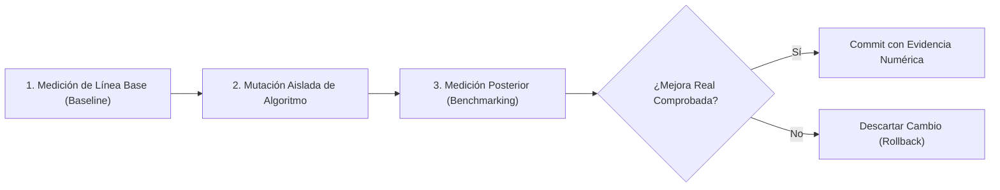

# Optimización Cuantitativa Empírica (Hillclimb Protocol)

Protocolo riguroso para optimizaciones de rendimiento y refactorizaciones algorítmicas, evitando "mejoras" teóricas o placebos.

---

## 1. El Peligro de las Optimizaciones a Ciegas

Los modelos de lenguaje tienden a asegurar que un cambio "mejora el rendimiento" basándose en intuiciones teóricas que a menudo resultan falsas en la práctica (ej. cambiar un bucle `for` clásico por `map/reduce` en JavaScript, o introducir paralelismo con overhead de sincronización peor que la ejecución secuencial).

---

## 2. El Protocolo de 3 Fases de Hillclimb

### Fase 1: Línea Base (*Baseline*)
- Ejecuta una prueba de rendimiento sobre el código actual antes de tocar nada.
- Mide tiempo de ejecución medio (sobre al menos 100-1000 iteraciones para descartar ruido del sistema operativo) o consumo de memoria.

### Fase 2: Mutación Aislada
- Aplica el cambio exclusivamente en la función o cuello de botella medido.
- La suite completa de pruebas unitarias debe seguir pasando en verde al 100%.

### Fase 3: Evidencia Numérica Obligatoria
- Ejecuta el mismo benchmark bajo exactamente las mismas condiciones.
- Solo se considera aceptada la optimización si se demuestra una reducción estadísticamente relevante:
  * *"Baseline: 142ms ± 5ms -> Post-optimización: 38ms ± 2ms (mejora de 73%)"*.
  * Si la diferencia es menor al 3-5%, se descarta el cambio para no aumentar la complejidad del código.
