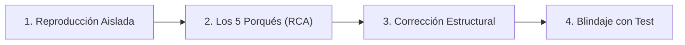

# 🔍 Metodología de Análisis de Causa Raíz (RCA) para Agentes de IA

El objetivo de este documento es erradicar el hábito más destructivo de los modelos de IA: **aplicar soluciones cosméticas o "parches curita" que silencian los síntomas pero dejan intacta la causa raíz de los errores.**

---

## 🚫 Los 5 Pecados Capitales del Debugging con IA

### 1. El Parche del "Null Check" Ciego
- **El síntoma**: `TypeError: Cannot read properties of undefined (reading 'id')`.
- **El parche malo de la IA**: `const id = user?.id || '';`
- **Por qué está mal**: Si `user` debía ser cargado obligatoriamente por el middleware de autenticación, usar `user?.id` simplemente propaga el valor vacío a la base de datos o genera un registro corrupto más adelante.
- **La solución real**: Investigar por qué el middleware de autenticación no resolvió el objeto `user`, verificar el token JWT y retornar un error 401 si no existe sesión.

### 2. Silenciar Excepciones a Ciegas
- **El síntoma**: `OperationalError: connection pool exhausted`.
- **El parche malo de la IA**:
  ```python
  try:
      db.save()
  except Exception:
      pass # Silenciado para que no falle el request
  ```
- **Por qué está mal**: Se pierden datos sin que el usuario ni el sistema de alertas se enteren.
- **La solución real**: Revisar dónde se abren conexiones sin cerrarse (leaks en el pool), implementar context managers (`with db.session():`) y reintentos con backoff exponencial.

### 3. Degradación de Tipos (`any`, `as unknown`, `@ts-ignore`)
- **El síntoma**: TypeScript se queja de incompatibilidad entre dos interfaces.
- **El parche malo de la IA**: `const result = (response.data as any).items;`
- **Por qué está mal**: Destruye la seguridad de tipos y traslada el error de tiempo de compilación a tiempo de ejecución en producción.
- **La solución real**: Definir correctamente los esquemas Zod/Pydantic/TypeScript que modelen la estructura real de la API externa.

### 4. Mocks Tautológicos que Ocultan la Realidad
- **El síntoma**: Un test falla al interactuar con un servicio.
- **El parche malo de la IA**: Modificar el mock para que devuelva siempre exactamente lo que la función espera recibir, probando el mock contra sí mismo.
- **La solución real**: Probar los contratos reales o usar mocks fieles al esquema OpenAPI/Proto oficial.

### 5. Reescritura Innecesaria de Módulos Enteros
- **El síntoma**: Un fallo sutil en una expresión regular o cálculo de fechas.
- **El parche malo de la IA**: Reescribir toda la clase desde cero, introduciendo 5 nuevos bugs en casos que ya funcionaban.
- **La solución real**: Aislamiento quirúrgico del bug con un test unitario enfocado en la entrada exacta que produce el fallo.

---

## 🛠️ El Ciclo RCA en 4 Pasos



1. **Aislamiento**: Extrae la entrada mínima reproducible (payload JSON, parámetros, estado de base de datos) que desencadena el error.
2. **Los 5 Porqués**: Pregunta "¿Por qué falló?" sucesivamente hasta encontrar la deficiencia de diseño o contrato de datos subyacente.
3. **Corrección Estructural**: Soluciona el problema en el punto exacto de la arquitectura donde se originó el dato inválido o la asunción errónea.
4. **Blindaje de Regresión**: Asegura que el caso de fallo esté cubierto en la suite automatizada para siempre.
