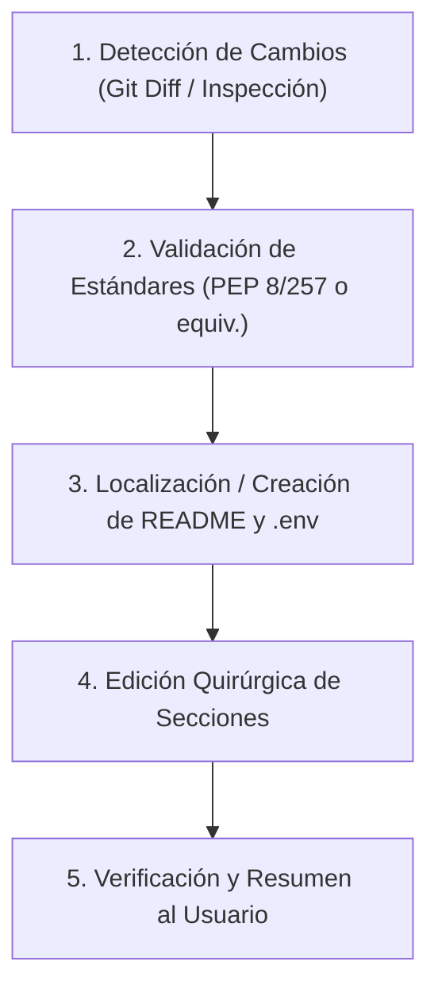

# 🛡️ Doc-Guardian: Sincronización Continua de Documentación y Estándares de Código

Esta skill proporciona una metodología rigurosa, automatizada y no destructiva para garantizar que ningún agente o modelo de IA olvide mantener al día el `README.md`, la documentación técnica y los **estándares de código y docstrings (PEP 8, PEP 257 o equivalentes)** cada vez que crea o modifica código en una base de datos.

---

## 🎯 Objetivo Fundamental: Cero Deuda de Documentación y Código Limpio
1. **Documentación Externa**: El código y su documentación evolucionan en el **mismo turno de trabajo**. Si un desarrollador clona el repositorio, todo lo necesario para instalar, configurar y ejecutar las nuevas funcionalidades está documentado en el `README.md`.
2. **Documentación Interna y Estilo**: Todo código nuevo o modificado debe cumplir rigurosamente con los estándares de formato y documentación del lenguaje (**PEP 8 y PEP 257 en Python, TSDoc/JSDoc en TypeScript/JavaScript, rustdoc en Rust, godoc en Go, Javadoc en Java**).

---

## 📐 Estándares de Código y Docstrings (PEP 8, PEP 257 o Equivalentes)

Antes de entregar cualquier fragmento de código, el agente debe validar el cumplimiento del estándar correspondiente:

### 1. Python: PEP 8 (Estilo) y PEP 257 (Docstrings)
- **PEP 8**:
  - Nomenclatura: `snake_case` para variables y funciones, `PascalCase` para clases, `UPPER_CASE` para constantes globales.
  - Tipado explícito con anotaciones (`def calculate(x: int) -> float:`).
  - Sangría de 4 espacios (sin tabs), longitud de línea <= 88-100 caracteres.
  - Agrupación de imports: biblioteca estándar, bibliotecas de terceros, módulos locales.
- **PEP 257**:
  - Triples comillas dobles `"""..."""` en todo módulo, clase, método y función pública.
  - Resumen imperativo de una línea (ej. `"""Devuelve el resumen estadístico de la muestra."""`).
  - Secciones explícitas de argumentos (`Args:`), retorno (`Returns:`) y excepciones (`Raises:`).

### 2. TypeScript / JavaScript: Prettier/ESLint y TSDoc/JSDoc
- Formato limpio (2 espacios), variables `camelCase`, tipos/interfaces `PascalCase`.
- Bloques `/** ... */` obligatorios en funciones y métodos exportados, detallando `@param`, `@returns` y `@throws`.

### 3. Rust: rustfmt y rustdoc
- Formato según `rustfmt`.
- Documentación con `///` para funciones/structs públicas y `//!` a nivel de módulo, incluyendo ejemplos doctest cuando corresponda.

### 4. Go: gofmt y GoDoc
- Formato oficial con `gofmt`.
- Comentario descriptivo antes de cada elemento exportado comenzando por su nombre: `// ProcessData procesa la cola de eventos.`.

### 5. Java / C#: Checkstyle y Javadoc / XML Comments
- Documentación con `/** ... */` o `/// <summary>` en clases, métodos y propiedades públicas.

---

## 🔍 Matriz de Disparadores de Documentación

Antes de finalizar cualquier tarea que involucre edición de código, el agente debe verificar la siguiente matriz de impacto:

| Tipo de Cambio en Código | Archivos Típicos Afectados | Acción Requerida en Documentación |
| :--- | :--- | :--- |
| **Nuevo Código / Funciones** | Archivos `.py`, `.ts`, `.rs`, `.go` | Aplicar estándares PEP 8 / PEP 257 (o equivalentes) con docstrings y tipos completos. |
| **Nuevas Dependencias** | `package.json`, `pyproject.toml`, `requirements.txt`, `Cargo.toml`, `go.mod` | Actualizar sección **Requisitos / Instalación** y comandos de setup. |
| **Variables de Entorno** | Usos de `process.env.*`, `os.getenv()`, `env::var()`, `System.getenv()` | Actualizar tabla de **Variables de Entorno** en `README.md` y sincronizar `.env.example`. |
| **Nuevos Scripts / Comandos** | `package.json` (`"scripts"`), `Makefile`, `taskfile.yml`, CLI entrypoints | Actualizar sección **Scripts Disponibles / Uso**. |
| **Rutas y Endpoints de API** | Archivos de routers (`express`, `fastapi`, `spring`, etc.) | Actualizar sección **Endpoints / API Reference** con método, ruta, parámetros y respuesta esperada. |
| **Cambios Arquitectónicos** | Nuevas carpetas, refactorizaciones de módulos, servicios nuevos | Actualizar diagrama o árbol de **Estructura del Proyecto**. |
| **Modo de Ejecución o Despliegue** | `Dockerfile`, `docker-compose.yml`, scripts de despliegue | Actualizar sección **Despliegue / Docker / Ejecución**. |

---

## 📋 Protocolo de 5 Pasos para el Agente



### Paso 1: Detección y Análisis de Impacto
Examina las modificaciones realizadas en la sesión:
- Ejecuta el script de auditoría:
  ```bash
  python C:/Users/Petiso/.gemini/config/plugins/doc-guardian/skills/doc-guardian/scripts/doc_guard.py check
  ```
  *(O ejecuta `git diff --stat` / `git status` si estás en un repositorio Git).*
- Identifica qué funcionalidades nuevas, parámetros o configuraciones se añadieron.

### Paso 2: Validación de Estándares de Código y Docstrings
- Revisa el código escrito o modificado:
  - ¿Cumple PEP 8 y PEP 257 si es Python? (nombres en snake_case, tipos explícitos, docstrings completos con Args/Returns).
  - ¿Cumple TSDoc/JSDoc si es JS/TS?
  - ¿Cumple rustdoc o godoc si es Rust o Go?
- Si alguna función pública carece de docstrings o documentación de parámetros, añádela antes de proceder.

### Paso 3: Evaluación y Creación de Documentación
- ¿Existe ya un `README.md` en la raíz del proyecto?
  - **NO**: Créalo inmediatamente a partir de la [Plantilla Estándar](./references/readme_template.md).
  - **SÍ**: Lee el contenido actual del `README.md` para identificar qué secciones requieren actualización y cuáles deben preservarse intactas.

### Paso 4: Edición Quirúrgica y No Destructiva
- **Nunca sobreescribas a ciegas** el `README.md` existente con un resumen genérico.
- Respeta la voz, badges, notas personalizadas y estilo previo del autor.
- Inserta o modifica únicamente los bloques pertinentes:
  - Añade la nueva variable a la tabla de `.env`.
  - Añade el nuevo comando a la lista de scripts.
  - Documenta la nueva opción de configuración o endpoint.
- Si se crearon variables de entorno, asegúrate de crear o actualizar `.env.example` en la raíz del proyecto (sin incluir secretos reales, solo nombres y placeholders descriptivos).

### Paso 5: Reporte de Documentación y Estándares al Usuario
En tu mensaje final al usuario, incluye siempre una sección explícita:
```markdown
### 📝 Documentación Actualizada y Estándares (Doc-Guardian)
- **Estándares de Código**: Cumplimiento de PEP 8 y PEP 257 (o equivalente TSDoc/JSDoc/rustdoc) verificado en todo el código modificado.
- **`README.md`**: Actualizada la sección de *Configuración* con la nueva variable `PORT` y el comando de migración `npm run db:migrate`.
- **`.env.example`**: Añadida la variable `DATABASE_URL` con valor de ejemplo.
```

---

## 🛠️ Herramienta CLI de Asistencia: `doc_guard.py`

Esta skill incluye un script de auditoría automática en Python que cualquier agente o usuario puede ejecutar en cualquier proyecto:

```bash
# Auditar si hay código modificado sin documentar en el README:
python <ruta_plugin>/skills/doc-guardian/scripts/doc_guard.py check

# Inyectar reglas automáticas en AGENTS.md, GEMINI.md o .cursorrules en el proyecto actual:
python <ruta_plugin>/skills/doc-guardian/skills/doc-guardian/scripts/doc_guard.py init
```

Para más detalles sobre cómo aplicar estas reglas a **Cursor, Claude Code, GitHub Copilot o Windsurf**, consulta la guía de [Reglas Universales para Modelos de IA](./references/universal_agent_rules.md).

---

## 📑 Suite Editorial de Exportación a PDF (`generate_perfect_pdf`)

Doc-Guardian incluye un motor de compilación editorial de alta resolución basado en **Playwright** y **Markdown-It** para transformar cualquier archivo Markdown (`README.md`, informes de auditoría, especificaciones de arquitectura, propuestas comerciales o preprints técnicos) en documentos PDF listos para impresión o presentación ejecutiva.

### Características del Motor PDF:
- **Paginación Estricta y Predecible:** Permite dividir páginas temáticas mediante separadores `---`, garantizando exactamente una sección por página sin cortes antiestéticos.
- **Incrustación Atómica de Imágenes (Base64):** Convierte capturas e imágenes locales a Data URIs para evitar bloqueos por políticas de origen cruzado en Chromium headless.
- **Sanitización Automática:** Filtra emojis informales y rutas locales privadas antes de renderizar.
- **Tipografía Editorial:** Encabezados institucionales, paginación dinámica (`Página X de Y`), tablas estilizadas y bloques de código protegidos contra particiones de página (`page-break-inside: avoid`).
- **Soporte Matemático:** Renderizado nítido de fórmulas KaTeX / MathJax 3.

### Comandos Disponibles:
```bash
# 1. Exportar mediante el comando integrado de Doc-Guardian:
python <ruta_plugin>/skills/doc-guardian/scripts/doc_guard.py pdf <archivo.md> [-o salida.pdf]

# 2. Ejecutar directamente el generador especializado:
python <ruta_plugin>/skills/doc-guardian/scripts/generate_perfect_pdf.py <archivo.md> [salida.pdf]
```
