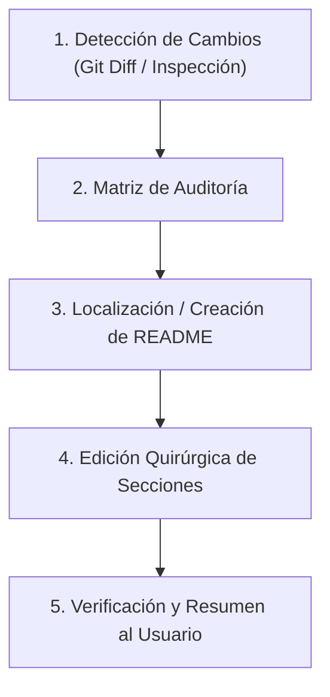

# 🛡️ Doc-Guardian: Sincronización Continua de Documentación

Esta skill proporciona una metodología rigurosa, automatizada y no destructiva para garantizar que ningún agente o modelo de IA olvide incluir y mantener al día el `README.md` y la documentación técnica cada vez que realiza cambios en una base de código.

---

## 🎯 Objetivo Fundamental: Cero Deuda de Documentación
El código y su documentación deben evolucionar en el **mismo turno de trabajo**. Si un desarrollador o usuario clona el repositorio o revisa las instrucciones tras los cambios de la IA, todo lo necesario para instalar, configurar y ejecutar las nuevas funcionalidades debe estar documentado con precisión.

---

## 🔍 Matriz de Disparadores de Documentación

Antes de finalizar cualquier tarea que involucre edición de código, el agente debe verificar la siguiente matriz de impacto:

| Tipo de Cambio en Código | Archivos Típicos Afectados | Acción Requerida en Documentación |
| :--- | :--- | :--- |
| **Nuevas Dependencias** | `package.json`, `pyproject.toml`, `requirements.txt`, `Cargo.toml`, `go.mod` | Actualizar sección **Requisitos / Instalación** y comandos de setup. |
| **Variables de Entorno** | Usos de `process.env.*`, `os.getenv()`, `env::var()`, `System.getenv()` | Actualizar tabla de **Variables de Entorno** en `README.md` y sincronizar `.env.example`. |
| **Nuevos Scripts / Comandos** | `package.json` (`"scripts"`), `Makefile`, `taskfile.yml`, CLI entrypoints | Actualizar sección **Scripts Disponibles / Uso**. |
| **Rutas y Endpoints de API** | Archivos de routers (`express`, `fastapi`, `spring`, etc.) | Actualizar sección **Endpoints / API Reference** con método, ruta, parámetros y respuesta esperada. |
| **Cambios Arquitectónicos** | Nuevas carpetas, refactorizaciones de módulos, servicios nuevos | Actualizar diagrama o árbol de **Estructura del Proyecto**. |
| **Modo de Ejecución o Despliegue** | `Dockerfile`, `docker-compose.yml`, scripts de despliegue | Actualizar sección **Despliegue / Docker / Ejecución**. |

---

## 📋 Protocolo de 5 Pasos para el Agente



### Paso 1: Detección y Análisis de Impacto
Examina las modificaciones realizadas en la sesión:
- Ejecuta el script de auditoría:
  ```bash
  python C:/Users/Petiso/.gemini/config/plugins/doc-guardian/skills/doc-guardian/scripts/doc_guard.py check
  ```
  *(O ejecuta `git diff --stat` / `git status` si estás en un repositorio Git).*
- Identifica qué funcionalidades nuevas, parámetros o configuraciones se añadieron.

### Paso 2: Evaluación del Estado Documental
- ¿Existe ya un `README.md` en la raíz del proyecto?
  - **NO**: Créalo inmediatamente a partir de la [Plantilla Estándar](./references/readme_template.md).
  - **SÍ**: Lee el contenido actual del `README.md` para identificar qué secciones requieren actualización y cuáles deben preservarse intactas.

### Paso 3: Edición Quirúrgica y No Destructiva
- **Nunca sobreescribas a ciegas** el `README.md` existente con un resumen genérico.
- Respeta la voz, badges, notas personalizadas y estilo previo del autor.
- Inserta o modifica únicamente los bloques pertinentes:
  - Añade la nueva variable a la tabla de `.env`.
  - Añade el nuevo comando a la lista de scripts.
  - Documenta la nueva opción de configuración o endpoint.
- Si se crearon variables de entorno, asegúrate de crear o actualizar `.env.example` en la raíz del proyecto (sin incluir secretos reales, solo nombres y placeholders descriptivos).

### Paso 4: Verificación de Comandos y Ejemplos
- Asegúrate de que los comandos documentados en el README funcionen exactamente como se describen (sintaxis para el sistema operativo o gestor de paquetes correspondiente: npm, pnpm, pip, uv, cargo, etc.).
- Si hay rutas o flags de CLI, asegúrate de que coincidan exactamente con la implementación del código.

### Paso 5: Reporte de Documentación al Usuario
En tu mensaje final al usuario, incluye siempre una sección explícita:
```markdown
### 📝 Documentación Sincronizada
- **`README.md`**: Actualizada la sección de *Configuración* con la nueva variable `PORT` y el comando de migración `npm run db:migrate`.
- **`.env.example`**: Añadida la variable `DATABASE_URL` con valor de ejemplo.
```

---

## 🛠️ Herramienta CLI de Asistencia: `doc_guard.py`

Esta skill incluye un script de auditoría automática en Python que cualquier agente o usuario puede ejecutar en cualquier proyecto:

```bash
# Auditar si hay código modificado sin documentar en el README:
python <ruta_plugin>/skills/doc-guardian/scripts/doc_guard.py check

# Inyectar reglas automáticas en AGENTS.md, GEMINI.md o .cursorrules en el proyecto actual:
python <ruta_plugin>/skills/doc-guardian/scripts/doc_guard.py init
```

Para más detalles sobre cómo aplicar estas reglas a **Cursor, Claude Code, GitHub Copilot o Windsurf**, consulta la guía de [Reglas Universales para Modelos de IA](./references/universal_agent_rules.md).

---

## 💡 Buenas Prácticas y Reglas de Oro

1. **Cero Suposiciones de Secretos**: Nunca documentes contraseñas, tokens reales o API keys en el README. Usa siempre valores ficticios (p. ej. `sk_test_...` o `tu_token_aqui`).
2. **Actualizaciones Incrementales**: Añade la información en la sección lógica. Si una sección no existe (p. ej. el proyecto no tenía sección de Variables de Entorno), créala en el lugar apropiado.
3. **Claridad sobre el Stack**: Si un cambio introduce un nuevo runtime o requisito de sistema (p. ej. Node >= 20, Python 3.12, Docker), márcalo explícitamente en los Requisitos Previos.
