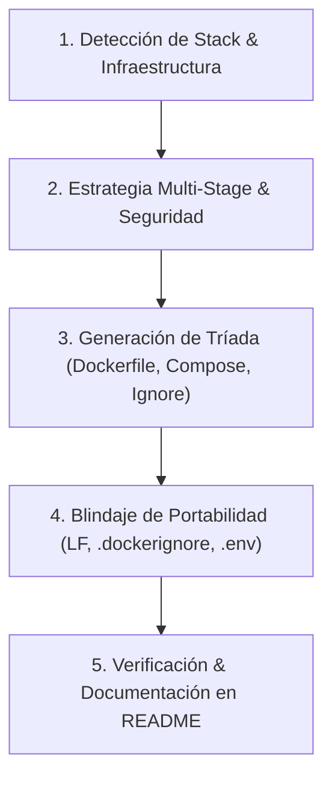

# 🐳 Docker-Guardian: Containerización y Portabilidad Universal

Esta skill proporciona una metodología estricta y automatizada para asegurar que cualquier proyecto desarrollado o asistido por IA esté **100% containerizado** y listo para ser clonado desde GitHub y ejecutado en cualquier computadora sin fricciones.

---

## 🎯 Objetivo Fundamental: Portabilidad Universal ("Zero Setup Run")

El estándar de oro de Docker-Guardian es:
> **Cualquier desarrollador o usuario que clone el repositorio desde GitHub debe poder ejecutar la aplicación en su máquina (Linux, macOS Apple Silicon o Intel, Windows WSL2/Docker Desktop) ejecutando un único comando (`docker compose up --build`), sin tener que instalar runtimes, lenguajes, gestores de paquetes ni bases de datos en su sistema operativo local.**

---

## 🔍 Matriz de Disparadores de Containerización

| Evento en el Proyecto | Archivos Afectados | Acción Requerida por el Agente |
| :--- | :--- | :--- |
| **Nuevo Proyecto / Servicio** | Raíz del proyecto | Generar `Dockerfile` multi-stage, `docker-compose.yml`, `.dockerignore`, `.gitattributes` y sección en `README.md`. |
| **Nuevas Dependencias** | `package.json`, `requirements.txt`, `Cargo.toml`, etc. | Si requieren librerías nativas del sistema (`build-essential`, `libpq-dev`, `ffmpeg`), actualizar el stage `builder` del `Dockerfile`. |
| **Variables de Entorno o Puertos** | `.env`, archivos de configuración, routers | Mapear puertos en `docker-compose.yml`, sincronizar `.env.example` y valores por defecto en Compose `${PORT:-XXXX}`. |
| **Nuevos Servicios de Datos** | DB, Redis, RabbitMQ, S3/MinIO | Añadir el servicio a `docker-compose.yml` con volumen persistente, healthcheck y `depends_on`. |
| **Script de Entrada Modificado** | `main.py`, `package.json` (`scripts`), etc. | Actualizar la directiva `CMD` / `ENTRYPOINT` del `Dockerfile`. |

---

## 📋 Protocolo de 5 Pasos para el Agente



### Paso 1: Detección de Stack e Infraestructura
Identifica el lenguaje, framework, gestor de dependencias y servicios auxiliares:
- Ejecuta la herramienta de auditoría:
  ```bash
  python C:/Users/Petiso/.gemini/config/plugins/docker-guardian/skills/docker-guardian/scripts/docker_guard.py check
  ```
- Determina si la app es:
  - API / Backend web (Node, Python, Go, Rust, Java).
  - Frontend SPA / SSR (Vite, React, Next.js).
  - Microservicio con base de datos (Postgres, Mongo, Redis).
  - Script CLI o worker en segundo plano.

### Paso 2: Estrategia Multi-Stage y Seguridad
- **Multi-Stage Obligatorio**: Divide en etapa de compilación (`builder` o `deps`) y etapa de ejecución (`runner`). La imagen final no debe contener compiladores ni herramientas innecesarias.
- **Usuario No Privilegiado (`non-root`)**: Añade un usuario dedicado (`USER appuser`) para prevenir riesgos de escalada de privilegios y problemas de permisos en Linux.
- Consulta las [Plantillas de Dockerfile](./references/dockerfile_templates.md) para el stack correspondiente.

### Paso 3: Generación de la Tríada de Containerización
1. **`Dockerfile`**: Optimizado para cachear capas de dependencias antes del código fuente.
2. **`docker-compose.yml`**: Orquestación 1-clic con mapeo de puertos e interpolación de variables. Consulta las [Plantillas de Docker Compose](./references/compose_templates.md).
3. **`.dockerignore`**: Exclusión rigurosa de `node_modules`, `.venv`, `.git`, `.env` y cachés locales.

### Paso 4: Blindaje de Portabilidad Universal
- **Saltos de línea (CRLF a LF)**: Genera `.gitattributes` para que los scripts `.sh` clonados en Windows no fallen con `\r: command not found` dentro del contenedor Linux.
- **Variables de Entorno**: Provee `.env.example` con valores funcionales por defecto para desarrollo local.
- Consulta la [Guía de Portabilidad](./references/portability_guide.md) para resolver casos específicos de Apple Silicon (ARM64 vs AMD64) y permisos de volúmenes.

### Paso 5: Sincronización en `README.md` y Reporte
- Asegúrate de que el `README.md` contenga la sección **🐳 Ejecución con Docker** con el flujo exacto de clonación y arranque.
- En tu mensaje final, reporta el estado bajo:
  ```markdown
  ### 🐳 Containerización y Portabilidad (Docker-Guardian)
  - **`Dockerfile`**: [Creado/Actualizado] Multi-stage para [Stack], usuario no-root configurado.
  - **`docker-compose.yml`**: [Creado/Actualizado] Puerto mapeado [XXXX:XXXX], servicios coordinados.
  - **`.dockerignore`**: Optimizado para excluir dependencias y temporales del host.
  - **Comando de inicio**: `docker compose up --build` -> `http://localhost:XXXX`.
  ```

---

## 🛠️ Herramienta CLI: `docker_guard.py`

Esta skill incluye una herramienta en Python para auditar y generar configuraciones de forma instantánea:

```bash
# Auditar si el proyecto cumple los estándares de Docker-Guardian:
python C:/Users/Petiso/.gemini/config/plugins/docker-guardian/skills/docker-guardian/scripts/docker_guard.py check

# Generar automáticamente la tríada de Dockerfile, docker-compose, .dockerignore y README:
python C:/Users/Petiso/.gemini/config/plugins/docker-guardian/skills/docker-guardian/scripts/docker_guard.py scaffold

# Inyectar reglas de containerización obligatorias en AGENTS.md / GEMINI.md del proyecto:
python C:/Users/Petiso/.gemini/config/plugins/docker-guardian/skills/docker-guardian/scripts/docker_guard.py init
```

---

## 🚀 Soporte Adicional: Dev Containers
Para permitir que cualquier desarrollador abra el proyecto directamente en **GitHub Codespaces** en el navegador sin instalar nada, consulta la [Guía de Dev Containers](./references/devcontainer_template.md).
