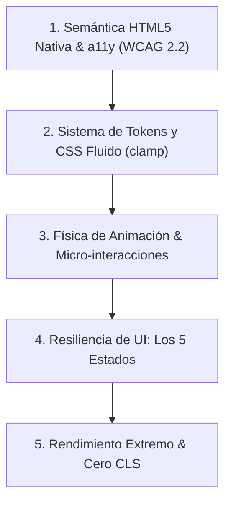

# 🎨 Frontend-Guardian: Excelencia Frontend, Accesibilidad y Resiliencia de UI

Esta skill complementa el motor estético de `impeccable` proporcionando estándares de ingeniería frontend para garantizar que las páginas y aplicaciones web sean **accesibles, resilientes, responsivas y de alto rendimiento**.

---

## 🧭 Flujo de Trabajo Contextual



---

## 📋 Los 5 Pilares de Frontend-Guardian

### 1. Semántica HTML5 y Accesibilidad Radical (a11y)
- **Elementos Nativos**: Nunca uses `<div onClick>` para botones o enlaces. Usa `<button>` o `<a href>`.
- **Formularios Accesibles**: Todo `<input>` debe tener un `<label for="...">` explícito.
- **Foco Visible**: Prohibido `outline: none` sin proveer `:focus-visible` de alto contraste.
- **Contraste**: Mínimo 4.5:1 para texto estándar y 3:1 para texto destacado.
- Consulta [Guía de Accesibilidad](./references/accessibility_a11y.md).

### 2. Tokens de Diseño y CSS Fluido
- **Escala Modular**: Espaciados basados exclusivamente en múltiplos geométricos de 4px / 8px (4, 8, 12, 16, 24, 32, 48, 64px).
- **Tipografía Fluida**: Usa `clamp()` en lugar de múltiples media queries rígidos.
- **Modo Claro/Oscuro Nativo**: Variables CSS semánticas (`--color-surface`, `--color-primary`) preparadas para `prefers-color-scheme`.
- Consulta [Tokens de Diseño y CSS Fluido](./references/design_tokens_and_fluid_css.md).

### 3. Motion y Micro-interacciones
- **Física Natural**: Transiciones con curvas orgánicas (`cubic-bezier(0.16, 1, 0.3, 1)`) o resortes (*springs*).
- **Sensibilidad al Movimiento**: Obligatorio anular animaciones en `@media (prefers-reduced-motion: reduce)`.
- Consulta [Motion y Micro-interacciones](./references/motion_and_microinteractions.md).

### 4. La Regla de los 5 Estados de UI
Todo componente que cargue datos asíncronos debe implementar:
1. *Vacío (Empty)* con llamada a la acción.
2. *Carga (Skeleton)* preservando el espacio para evitar CLS.
3. *Éxito / Datos listos*.
4. *Error reintentable* en lenguaje humano comprensible.
5. *Parcial o Deshabilitado*.
- Consulta [UX de Formularios y Estados](./references/form_and_state_ux.md).

### 5. Core Web Vitals y Rendimiento
- **Cero Layout Shift (CLS = 0)**: Imágenes y videos con `aspect-ratio` o atributos `width`/`height`.
- **Fuentes Web**: `font-display: swap` obligatorio.
- Consulta [Core Web Vitals y Rendimiento](./references/core_web_vitals_performance.md).

---

## 🛠️ Auditoría Automatizada con `frontend_guard.py`

```bash
python C:/Users/Petiso/.gemini/config/plugins/frontend-guardian/skills/frontend-guardian/scripts/frontend_guard.py .
```

---

## 📝 Protocolo de Reporte Final
En toda respuesta que involucre maquetación, componentes o diseño frontend, incluye el bloque:

```markdown
### 🎨 Diseño y Frontend (Frontend-Guardian)
- **Semántica & a11y**: [HTML5 semántico / Roles ARIA / Foco visible / Contraste verificado].
- **Tokens & Espaciado**: [Escala 4/8px respetada / Tipografía fluida con clamp / Sin px arbitrarios].
- **Motion & Resiliencia**: [Curvas naturales con prefers-reduced-motion / Los 5 estados de UI cubiertos].
- **Core Web Vitals**: [Cero CLS / Dimensiones en medios / Carga optimizada].
```
