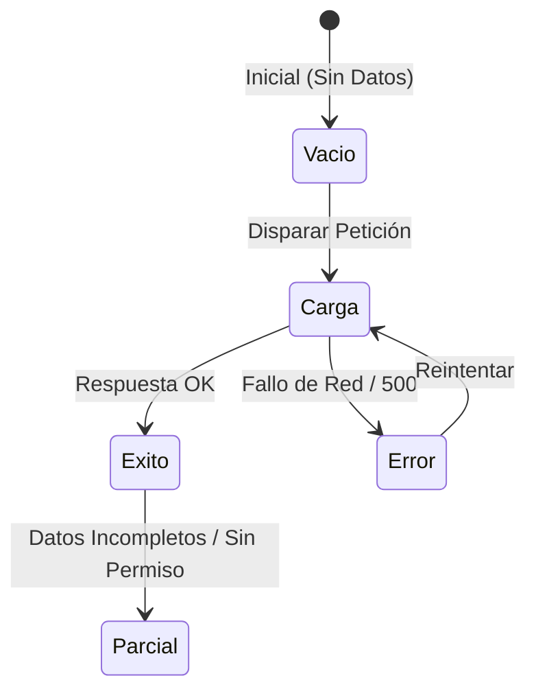

# UX de Formularios y la Regla de los 5 Estados de UI

Metodología para construir interfaces robustas que nunca se queden congeladas o rotas.

---

## 1. La Regla de los 5 Estados

Cualquier componente que consulte una API o realice mutaciones asíncronas debe manejar 5 estados visuales diferenciados:

1. **Estado Vacío (*Empty State*)**:
   - Nunca muestres una pantalla en blanco.
   - Incluye una ilustración o icono sutil, una explicación clara ("Aún no tienes proyectos creados") y un botón primario para crearlo de inmediato.
2. **Estado de Carga (*Skeleton Screen*)**:
   - En lugar de un spinner flotante en el centro que no da contexto espacial, usa cajas con shimmer que repliquen la forma exacta del contenido final, manteniendo el layout estable.
3. **Estado de Éxito / Contenido Listo**:
   - El renderizado habitual con datos.
4. **Estado de Error Reintentable**:
   - Mensaje amigable en lenguaje humano (nunca `Error 500: Internal Server Error` crudo).
   - Botón directo para reintentar la acción.
5. **Estado Parcial o Deshabilitado**:
   - Indicador visual claro (opacidad reducida, tooltip explicativo de por qué no está disponible).

---

## 2. Validación de Formularios no Invasiva

- **Validación en `onBlur`**: Valida cuando el usuario termina de interactuar con el campo y pasa al siguiente, no en cada pulsación de tecla mientras aún está escribiendo.
- **Prevención de Doble Envío**: Deshabilita el botón de envío y muestra un estado de carga inmediatamente tras el primer clic.
- **Persistencia de Borrador**: En formularios extensos, guarda los cambios en `localStorage` o `sessionStorage` para no perder el trabajo ante una recarga accidental.
