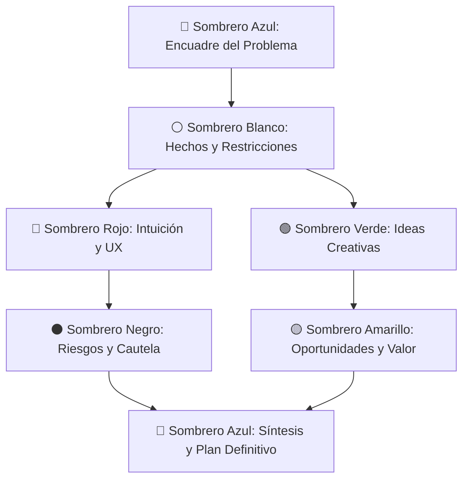

# Consejo de los 6 Sombreros (Six Hats Council)

Permite al agente ejecutar una sesión de deliberación multidimensional basada en la metodología de los **6 Sombreros para Pensar de Edward de Bono**, utilizando **el mismo modelo LLM** para explorar facetas cognitivas ortogonales antes de sintetizar un plan de implementación definitivo.

A diferencia de un consejo multi-modelo tradicional (que requiere múltiples API keys y suele converger en respuestas genéricas promedio), este enfoque fuerza polarizaciones dialécticas deliberadas: datos objetivos (Blanco), intuición y experiencia de usuario (Rojo), riesgos y fallos críticos (Negro), optimismo y valor (Amarillo), creatividad disruptiva (Verde) y facilitación/síntesis ejecutiva (Azul).

---

## Cuándo Activar esta Skill

Activa este protocolo cuando el usuario use frases como:
- *"Consulta con el consejo: [pregunta o decisión técnica]"*
- *"Aplica los 6 sombreros para evaluar si deberíamos..."*
- *"Haz una sesión de los sombreros de Bono antes de planificar..."*
- *"Analiza esta arquitectura desde todos los ángulos"*
- *"¿Qué opina el consejo de sombreros sobre este enfoque?"*

---

## Protocolo de Deliberación (Paso a Paso)

Cuando se active la deliberación, el agente debe proceder en las siguientes fases ordenadas:



### Fase 1: Encuadre y Hechos Objetivos
1. 🔵 **Sombrero Azul (Apertura)**:
   - Define con precisión el dilema técnico, la decisión o la funcionalidad a construir.
   - Establece los criterios de éxito y las restricciones no negociables.
2. ⚪ **Sombrero Blanco (Datos Puros)**:
   - Enumera exclusivamente información factual: versiones del stack, dependencias instaladas, volumen de datos estimado, restricciones de hardware/red, y **qué información crítica falta**.
   - *Regla*: Prohibido dar opiniones, sesgos o juicios de valor.

### Fase 2: Pensamiento Divergente y Percepción
3. 🔴 **Sombrero Rojo (Intuición, Sentimientos y UX)**:
   - Expresa las sensaciones viscerales del desarrollador y del usuario final: ¿Qué partes del diseño se sienten frágiles, confusas, sobrecargadas o agradables?
   - *Regla*: Las opiniones no requieren justificación lógica ni demostración técnica formal.
4. 🟢 **Sombrero Verde (Creatividad y Pensamiento Lateral)**:
   - Propone alternativas fuera de la caja: ¿Qué pasaría si no usamos base de datos relacional? ¿Y si invertimos el flujo? ¿Hay un atajo innovador o patrón poco común que simplifique el 80% del esfuerzo?
   - *Regla*: Sin autocensura. La viabilidad se evaluará más adelante.

### Fase 3: Tensión Dialéctica (Crítica vs. Valor)
5. ⚫ **Sombrero Negro (Abogado del Diablo & Riesgos)**:
   - Identifica con crudeza los puntos de fallo: vulnerabilidades de seguridad, condiciones de carrera, deuda técnica oculta, pesadilla de mantenimiento a 2 años, costes ocultos.
   - *Pregunta clave*: ¿Por qué este proyecto o arquitectura podría fracasar estrepitosamente?
6. 🟡 **Sombrero Amarillo (Optimismo & Beneficios)**:
   - Defiende el mejor escenario posible fundamentado: ahorro de tiempo de desarrollo, escalabilidad futura, mejora en la satisfacción del equipo y ROI.
   - *Pregunta clave*: ¿Por qué vale totalmente la pena hacer esto y cómo maximizamos sus virtudes?

### Fase 4: Síntesis Ejecutiva y Plan Maestro
7. 🔵 **Sombrero Azul (Cierre y Plan de Acción)**:
   - Resuelve los conflictos directos (p. ej., cómo las ideas del Sombrero Verde resuelven los riesgos advertidos por el Sombrero Negro).
   - Genera una **Matriz de Deliberación** resumida.
   - Elabora el **Plan de Implementación Definitivo** estructurado por fases, con mitigaciones explícitas para cada riesgo del Sombrero Negro.

---

## Formato de Salida Esperado

La respuesta al usuario debe estructurarse con la siguiente plantilla:

```markdown
# 🎩 Consejo de los 6 Sombreros: [Título del Problema]

## 1. Deliberación de las Voces

### 🔵 Azul (Encuadre)
[Objetivo central y preguntas a responder]

### ⚪ Blanco (Hechos y Datos)
- **Hechos verificados**: ...
- **Incógnitas / Datos faltantes**: ...

### 🔴 Rojo (Intuición y UX)
- **Gut feeling técnico**: ...
- **Fricción percibida**: ...

### 🟢 Verde (Alternativas Creativas)
- **Propuesta disruptiva A**: ...
- **Enfoque lateral B**: ...

### ⚫ Negro (Riesgos y Fallos Críticos)
- ⚠️ **Riesgo 1**: ...
- ⚠️ **Riesgo 2**: ...

### 🟡 Amarillo (Valor y Oportunidades)
- ✨ **Beneficio principal**: ...
- ✨ **Ventaja competitiva**: ...

---

## 2. Matriz de Síntesis y Tensiones Resueltas

| Tensión / Conflicto | Voz Crítica (Negro) | Respuesta / Mitigación (Verde / Amarillo) | Veredicto Azul |
| :--- | :--- | :--- | :--- |
| Ejemplo: Rendimiento vs Simplicidad | Cachear en memoria saturará RAM | Usar LRU acotado o Redis ligero | Adoptar LRU acotado en Fase 1 |

---

## 3. Plan de Implementación Definitivo (Sombrero Azul)

1. **Fase 1: Preparación y Validación de Datos (Blanco)**
2. **Fase 2: Arquitectura Core con Mitigación de Riesgos (Negro + Verde)**
3. **Fase 3: Refinamiento de Experiencia y Valor (Rojo + Amarillo)**
```

---

## Recursos y Referencias Adicionales

- Consulta la guía profunda de cada sombrero y sus límites en [hats_framework.md](./references/hats_framework.md).
- Si deseas plantillas de prompts aislados o subagentes, revisa [prompt_templates.md](./references/prompt_templates.md).
- Para ejecutar la deliberación mediante un script Python automatizado en CLI, utiliza [six_hats.py](./scripts/six_hats.py).
